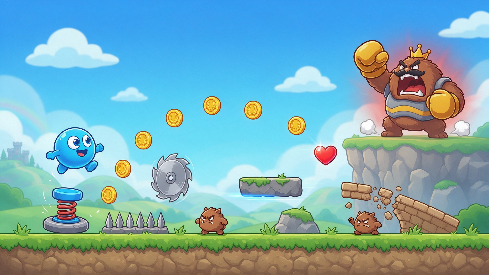

# Platform Quest: 2D Platformer Template

A complete side-scrolling platformer for Summer Engine: stomp combat, hazards, a boss, and levels you write as text files. Use it as a starting point you can rip apart, reskin or extend.

## What's inside

- **4 levels and a boss room**: the Critter King paces the arena, telegraphs charge-dashes, enrages as it loses health and takes 3 stomps to beat.
- **Levels as plain-text ASCII maps**: add a level by dropping in a text file.
- **Platforms and hazards**: moving platforms, slopes, bounce pads, crumbling blocks, spikes and sawblades.
- **Stomp combat**: jump on enemies to defeat them; a side hit costs a heart (3 hearts, i-frames, knockback).
- **Pickups and HUD**: animated coins with a counter, hearts that restore health.
- **Menus and audio**: main menu, Game Over and You Win screens, menu / gameplay / boss music and a full SFX layer.

All sprites and sounds are first-party and free to reskin or ship. Sprites are drawn by small PowerShell scripts in `tools/`; audio was made in Summer Studio.

## Get started

1. Download this repo as a [ZIP](https://github.com/SummerEngine/template-2d-brario-platformer/archive/refs/heads/main.zip) or clone it.
2. Open the folder in [Summer Engine](https://www.summerengine.com/download), or create a new project from this template inside Summer.
3. Press Play.

It is a standard Godot 4.6 (Mono) project. On first open the editor re-imports the assets (the `.godot/` cache and `*.import` files are gitignored).

Summer's AI agent can extend the game for you. Try:

- "Write a fifth level with a long sawblade gauntlet and a hidden heart."
- "Add a flying enemy that swoops at the player and can be stomped."
- "Add a double jump the player unlocks after level 2."

## Controls

| Action | Keys |
|--------|------|
| Move   | `A` / `D` or `←` / `→` |
| Jump   | `Space`, `W` or `↑` |

Jump on an enemy's head to stomp it. Reach the door to finish a level; beat the boss to win.

## How the level system works

Levels are **32×32-pixel grids** stored as text files in `levels/` (`level_01.txt` … `level_04.txt`). Each character is one tile. [`scripts/level_loader.gd`](scripts/level_loader.gd) reads the current level, instances the matching scene at each cell and sets the camera bounds.

| Char | Tile | Char | Tile |
|:---:|------|:---:|------|
| `.` | empty (sky) | `o` | bounce pad |
| `#` | solid block / ground | `x` | crumbling block |
| `P` | player spawn | `^` | spike |
| `G` | critter (walking enemy) | `s` | sawblade |
| `D` | exit door | `B` | boss |
| `-` | horizontal moving platform | `c` | coin |
| `\|` | vertical moving platform | `h` | heart |
| `/` | slope up | `\` | slope down |

**To add a level:** drop a new `levels/level_05.txt` and add its path to the `level_files` array in [`scripts/game_manager.gd`](scripts/game_manager.gd). **To add a tile type:** make a scene for it and add a `match` case in `level_loader.gd`.

## Project structure

```
project.godot        # Godot 4.6 project (boots to scenes/MainMenu.tscn)
levels/              # ASCII level maps
scenes/              # Player, enemies, platforms, pickups, UI, boss, menus
scripts/             # Player controller, enemies, level loader, GameManager autoload, HUD, audio
assets/sprites/      # sprite PNGs
assets/audio/        # music + SFX
tools/               # PowerShell scripts that draw the sprites and splash art
```

`GameManager` (autoload) owns lives, coins, level progression and music; `Sfx` (autoload) is a pooled one-shot sound player.

## License

MIT, see [LICENSE](LICENSE).
